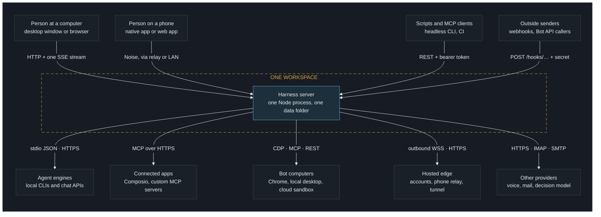
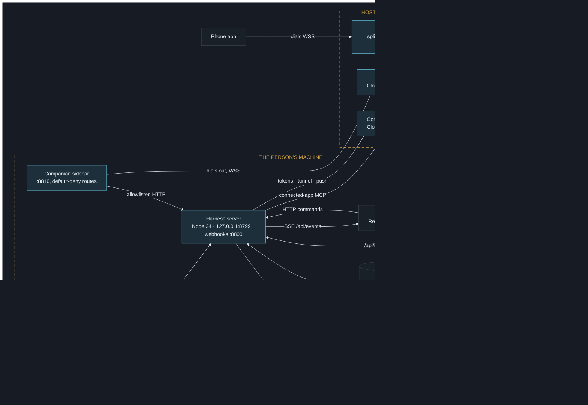
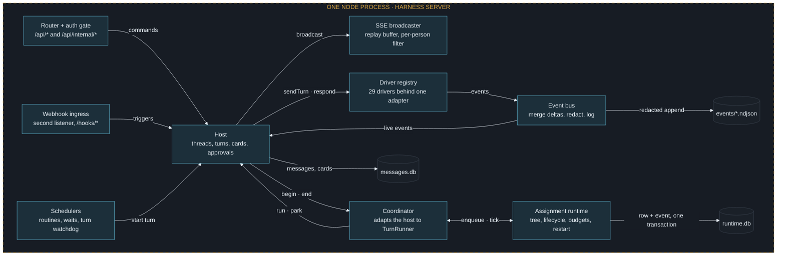
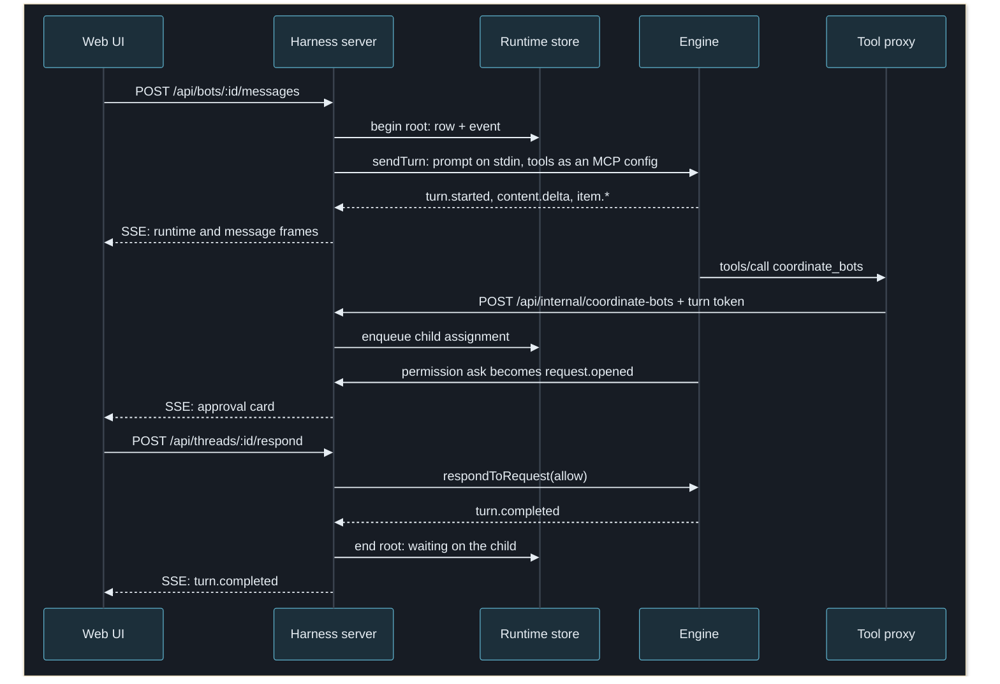
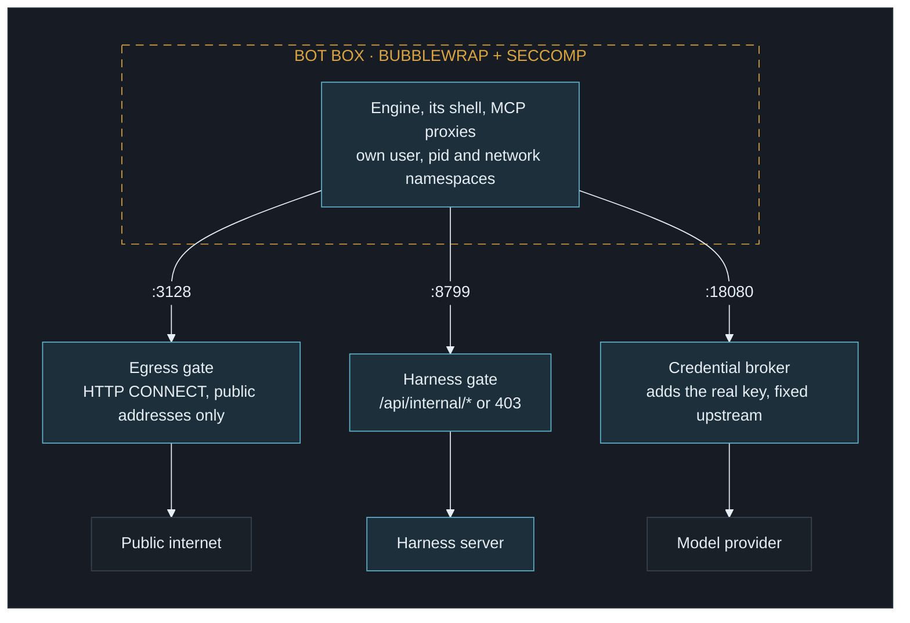
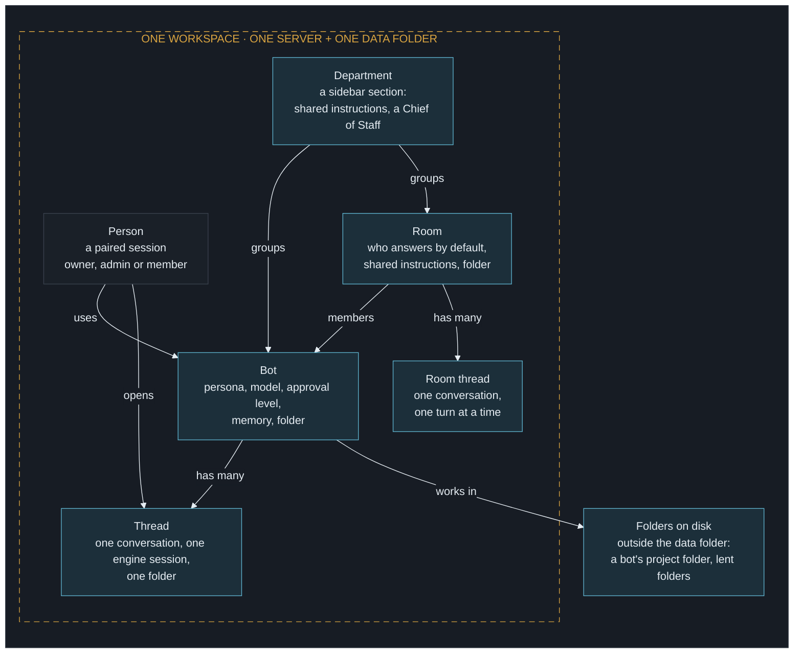

# OpenMausBot: system design

OpenMausBot is the reference project for our design (decision D2). This file
describes its architecture and how its parts connect. It uses the C4 model
(context, containers, components) and adds the views that a system design
document usually has: one turn as a sequence, data, interfaces, trust
boundaries, deployment, trade-offs and the domain model. The feature-by-feature table with the
Rust crate for each technique is in [`../comparison.md`](../comparison.md).

- **Date:** 2026-11-21
- **Version read:** 0.1.157, commit `6ae15f252` of
  `/Users/liam/orca/OpenMausBot`. `comparison.md` cites 0.1.170, so the two
  files can differ in places.
- **Method:** three readers each took one area of the code (server core;
  engines, tools and sandbox; clients and hosted services). Paths are in the
  OpenMausBot repository.
- **Not read:** the `enterprise/` directory (see decision D2).
- **Not in the repository:** the Admin service for hosted homes, and the
  native phone applications.

## Main finding

One Node process, the harness server, owns each agent engine, all state and
each outbound call. Each other part is a client of that server or an edge in
front of it. The UI has no transport of its own: it sends commands over HTTP
and folds one event stream.

## 1. Scope and requirements

Functional:

- Run a team of bots. Each bot is a persona on an existing agent engine (a CLI
  such as Claude Code or Codex, or a chat API).
- Let bots hand work to each other, wait for results and ask the person
  questions.
- Ask before an action: four approval levels, `ask < edits < auto < full`.
- Give bots tools: memory, a browser, a computer, connected apps, files,
  schedules and webhooks.
- Reach the same workspace from a desktop window, a browser, a phone, a script
  or an MCP client.

Quality drivers:

| Driver | How the design answers it |
|---|---|
| Local first | Keys and conversations stay in one data folder. The server binds to loopback. |
| Engine independence | 29 drivers behind one contract. A rule reads a capability flag, never a driver name. |
| Crash safety | Each state change of delegated work is a row and an event in one SQLite transaction. A cut turn runs again one time at most. |
| Untrusted model output | The text that opens a delegated turn is built from stored data. A secret reaches a tool, and the model does not see it. |
| Small failures | An unknown or broken driver becomes "unavailable". The other engines continue. |

## 2. System context (C4 level 1)



The clients on the left call in. The workspace dials each connection on the
right, also the connections to the hosted relay and the tunnel. Thus the
computer needs no open inbound port.

## 3. Containers (C4 level 2)



Each arrow into the harness server is loopback HTTP. The companion sidecar is
the only process that listens off the machine. The sidecar and the phone both
dial the relay. The relay joins the two encrypted sockets and cannot read
them.

| Container | Where | Technology | Responsibility | Source files |
|---|---|---|---|---|
| Harness server | `server/` | Node 24, raw `node:http`, `node:sqlite` | API, engines, runtime, tools, schedulers, storage | 1,436 |
| Web UI | `src/` | React 19, Vite, Tailwind | Chat shell. `fetch` on relative paths, one `EventSource`, one reducer | 1,093 |
| Wire contract | `packages/phone-protocol`, `shared/` | Plain TypeScript types | Runtime events and wire types for server, UI and phone. The server validates at its edges with `zod` | 253 |
| Desktop shell | `electron/` | Electron, `utilityProcess.fork` | Starts the server and the sidecar; OS keychain, updater, speech, computer control, tray, deep links | 196 |
| Companion sidecar | `companion/` | Node built-in modules only | Pairing, device tokens, route allowlist, encrypted transport for phones and other desktops | 40 |
| Phone relay | `relay/` | Node WebSocket behind Caddy | Joins a phone socket and a host socket. Checks a signed token offline. No disk state | 15 |
| Control plane | `cloudflare/control-plane` | Worker, D1, email binding | Accounts by email code, installations, tunnel provisioning, relay tokens, push to phones | 17 |
| Connected-apps broker | `cloudflare/composio-broker` | Worker, D1 | Holds the shared Composio key, proxies MCP, queues app events that the server long-polls | 9 |
| Server agent | `connector/` | Node built-in modules only | Runs a hosted home on a customer's own server over one outbound WebSocket | 28 |

The counts do not include tests. There are approximately as many test files:
1,570 in `server/` alone.

## 4. Components of the harness server (C4 level 3)

The server has one composition root, `server/index.ts`, of approximately
15,400 lines. At start it builds each part in a fixed order: data-folder
lease, sessions, vault, config, driver registry, event bus, store,
coordinator, schedulers, webhook listener, then the HTTP listener.



Two loops meet at the host:

- **Engine loop:** host, registry, engine, bus, host, then SSE.
- **Work loop:** host, coordinator, runtime, and back through the `TurnRunner`
  port.

The runtime does not touch an engine, a thread or the UI. The bus writes only
its redacted log; a live subscriber gets the event as the driver sent it.

| Component | Source | Contract |
|---|---|---|
| Router + auth gate | `routes/`, `request-auth.ts` | An ordered table of handlers. A handler returns `PASS` to decline. Pairing routes run before the gate, all others after it. 1 MB body limit. |
| Host | `index.ts`, `host/*` | Implements `CoordinatorHost`: `validate`, `busy`, `run`, `park`, `report`, `changed`. Owns engines, threads, cards, names and notifications. |
| Driver registry | `harness/registry.ts`, `contracts.ts`, `drivers/` | `ProviderDriver.create()` gives an adapter with `sendTurn`, `interruptTurn`, `respondToRequest`, optional `steer`, and `onEvent`. |
| Event bus | `harness/bus.ts` | Fan-in of `RuntimeEvent`. Merges `content.delta` for each thread, appends the redacted event to the log, and a terminal event forces a flush. |
| Coordinator | `runtime-coordinator.ts` | Opens `runtime.db`, builds the runtime with a depth limit of 4, and writes the envelope that opens each delegated turn. |
| Assignment runtime | `runtime/` | One record and one lifecycle for all handed-off work. Reaches the host only through `TurnRunner`. Returns typed refusals and never throws into a turn. |
| Schedulers | `routines.ts`, `handoff-ticks.ts`, `host/*` | Runtime tick (250 ms busy, 10 s parked, 1 h idle), cron routines, waits, a 60 s stall watchdog, daily retention sweeps. |
| SSE broadcaster | `index.ts` | Frames with `id: <stream>:<seq>`, replay on `Last-Event-ID`, a 15 s heartbeat. Each frame is filtered for the person who reads it. |

The drivers by transport (`server/drivers/builtIn.ts`):

| Transport | Drivers |
|---|---|
| stdio, stream-JSON lines | Claude (`claude -p`) |
| stdio, JSON-RPC app server | Codex (`codex app-server`) |
| stdio, ACP (JSON-RPC, shared core in `drivers/acp/core.ts`) | 16 agent CLIs, and a custom ACP entry |
| HTTPS `/chat/completions` or `/responses` | 9 chat-API providers, and an OpenAI-compatible entry |
| Other stdio protocols | Pi (`pi --mode rpc`), Muse Code (`muse serve`) |

## 5. One turn, with a hand-off and an approval



The engine does not call the server directly. Its tool call goes to a small
stdio proxy that the server gave it. The proxy calls loopback with a token
that was made for this bot, thread and turn. When the child assignment
settles, the runtime wakes the requester with one resume turn that carries the
result.

The assignment lifecycle (`docs/runtime-contract.md`, section 2):

```
queued ──admit──> running ──turn ends──> completed | failed | cancelled
                    │  └─ handed out work ──> waiting ──all children settled──> resume ──> running
                    └─ question for the person ──> needs_input ──answer──> running
```

- Each turn is a root: a person's message, a routine run, a webhook, a room
  member's turn.
- A terminal outcome is written one time, reported one time, and wakes the
  requester one time at most.
- Each root has three budgets (requests, executions, wakes) and three clocks
  (queue, tree stall, turn activity). Time parked on the person is charged to
  none of them.
- After a restart, a cut turn runs again one time. It does not run again if
  the activity rows of the thread show that it acted outward (sent, posted,
  pushed, paid).

How an approval reaches the server, for each engine type:

| Engine | Path |
|---|---|
| Claude | `--permission-prompt-tool` names an MCP tool. That tool sends JSON lines through a Unix socket (a named pipe on Windows), one socket for each bot and thread, file mode 0600. |
| Codex | An app-server request (`requestApproval`) on the same stdio connection. |
| ACP | `session/request_permission`. Only an option of an allow kind approves. |
| Chat API | The server runs the tool loop, so the ask is a gate in the server. |

Each path becomes a `request.opened` event. The approval level, a safety
floor and the saved exact commands can answer before a card shows. The answer
goes back with `respondToRequest` on the same channel.

## 6. Data

All state is in one data folder, `~/.openmausbot` by default. A lease file
permits one server for each folder. There is no database server.

| Store | Format | Contents | Owner |
|---|---|---|---|
| `config.json` | JSON, schema-checked | Engines, features, MCP servers. Secrets only as `vault:<id>` pointers | `config.ts` |
| `bots.json`, `groups.json` | JSON, atomic write | Bots with their threads; rooms | `store.ts` |
| `messages.db` | SQLite, WAL | Messages, thread state, queued follow-ups, command receipts, FTS5 indexes for recall | `message-db.ts` |
| `runtime.db` | SQLite, WAL | `assignments`, `assignment_events` (append-only), `inbox` | `runtime/store.ts` |
| `events/<thread>.ndjson` | NDJSON, mode 0600 | The redacted event log. Tool output and progress are live only | `harness/bus.ts` |
| `workspaces/<bot>/` | Markdown | `MEMORY.md`, topic files, archive, daily log, and the working folder of the bot | `memory-store.ts` |
| `logins.json.enc`, `member-secrets.json.enc` | AES-256-GCM | Saved logins and secrets. The key file is never in a backup | `vault-store.ts` |
| `routines.json`, `webhooks.json` | JSON | Schedules with their run ledger; webhook definitions with secret hashes | `routines.ts`, `webhooks.ts` |
| `usage/YYYY-MM.jsonl` | JSONL | Usage ledger for caps | `usage-ledger.ts` |
| `sessions.json` | JSON | Paired sessions; only the SHA-256 of each token | `sessions.ts` |

## 7. Interfaces

| From | To | Protocol | Credential |
|---|---|---|---|
| Web UI | Server `:8799` | HTTP JSON; SSE on `/api/events`; WebSocket for screen streams | Loopback and a desktop owner header, or a session cookie or bearer |
| Desktop shell | Server | Fork with a private message port | An owner token for each launch, not passed in the environment |
| Server | Claude engine | stdio, stream-JSON lines | The sign-in of the CLI |
| Server | Codex engine | stdio, JSON-RPC 2.0 app server | The sign-in of the CLI |
| Server | ACP engines | stdio, JSON-RPC (`session/prompt`) | The sign-in of the CLI |
| Server | Chat-API engines | HTTPS `/chat/completions`, streamed | The API key of the person |
| Engine | Tool proxy | MCP over stdio | None; the proxy is a child of the engine |
| Tool proxy | Server `/api/internal/*` | Loopback HTTP | A bearer made for each bot, thread and turn |
| Claude permission tool | Server | Unix socket or named pipe, JSON lines | File mode 0600 |
| Outside sender | Server `:8800` | HTTP `POST /hooks/…` | A secret for each hook, or a key for each bot. Only the hash is stored |
| MCP client, headless CLI | Server | REST, and SSE for waits | A bearer token from a 0600 file |
| Phone | Companion sidecar | Noise NKpsk0 on P-256, then yamux streams that carry HTTP | A device token from QR pairing |
| Phone, sidecar | Relay | Outbound WSS from both sides | An Ed25519-signed token from the control plane |
| Server, desktop | Control plane | HTTPS | An installation credential |
| Server | Composio or the broker | MCP over HTTPS; a 25 s long-poll for app events | A project key, or an installation bearer |
| Server | Browser of a bot | Chrome DevTools Protocol | A pipe or a local WebSocket; a SOCKS gate on the way out |
| Server | Cloud computer | HTTPS REST to the sandbox service | A key that stays on the server |

The tools that an engine gets are MCP servers, mounted for each turn
(`server/drivers/turn-mcp.ts`): `agents` (hand-offs, memory, pages, waits),
`composio`, `browser`, `data`, `email`, `device`, `computer`, then the custom
servers of the person. An ACP engine that can reach an MCP server by URL gets
`/api/internal/mcp-http/<kind>` and no proxy process.

## 8. Trust boundaries

- **Loopback is not sufficient.** A request with a forwarded header, from the
  tunnel socket or from the LAN, needs a session. A credential that is
  presented but not valid gets a 401 and does not fall back to loopback trust.
- **The model is outside the boundary.** The line that opens a delegated turn,
  `[From who · what · authority]`, is written from stored rows. An imitation
  of it in model text or person text is escaped.
- **The server answers approvals.** No bot message approves a permission.
- **Secrets pass by reference.** A bot gets a single-use `secret-ref:` that
  only the tools of the server accept, or the server types a login into the
  browser itself. Values are masked in transcripts and logs.
- **Logs are redacted before they reach disk.** The live stream carries the
  original event, and the exact command input is removed before a client gets
  it.

The bot box (`server/bot-box/`) is the sandbox for an engine. It is for Linux
only, and it is on by default only on a hosted home.



A boxed engine sees three loopback ports and nothing else. A Unix socket
bridges each port to a gate outside the box. The engine does not hold a
provider key: the broker adds the key to a request that already has a fixed
destination.

## 9. Deployment

| Topology | The server runs as | Clients reach it by | Edge in front |
|---|---|---|---|
| Desktop, embedded | A utility process of the Electron application | The window loads `http://127.0.0.1:<port>` | Optional: the sidecar with a managed Cloudflare tunnel, Tailscale or the relay |
| Docker Compose | The container `omb` with a data volume | HTTP on `:8080` | A Caddy container that reaches the server over two Unix sockets. Thus each request counts as remote |
| Command on a server | `openmausbot serve` under a service manager | A paired session | One of `--tunnel`, `--domain`, `--tailscale`, `--lan`, `--relay` |
| Hosted home | One Fly machine for each customer, or the customer's own server through the server agent | A pairing link that the Admin service signs | The proxy of the hosting platform |

A desktop can also attach to a remote server: the window loads the remote
origin, and no local server starts. Servers do not peer with each other. In
the source, "peer" means two bots on one server.

## 10. Decisions and trade-offs

| Decision | Advantage | Cost |
|---|---|---|
| The UI has no transport; one SSE stream and one reducer | The desktop, the browser and the phone are the same client. A reconnect is a replay from a cursor | Each feature needs a server route. A stream gap outside the buffer forces a full snapshot |
| One event union for all engines | The UI, the log, the watchdog and the evaluations are written one time | Each driver has a translation layer, and engine differences go into adapter files |
| Tools reach engines as MCP servers that call back over loopback | An engine that speaks MCP gets each tool. The turn token limits each call | One process for each tool family for each turn, unless the engine takes an MCP URL |
| A separate assignment runtime behind a port | Delegation is tested with fake engines; ten invariants are checked after each scenario | The host keeps a second view of work state during the migration that the contract describes |
| Files and SQLite, no database server | A backup is a folder copy. Nothing to install | One writer for each folder; the JSON stores need atomic writes |
| Protocols written by hand on Node built-in modules | Few dependencies; full control of framing and limits | A large surface to maintain: MCP, ACP, JSON-RPC, SSE, Noise and yamux are all in the tree |
| One composition root of 15,400 lines | The boot order reads from top to bottom | The host is the most difficult file to change; route modules are moving out of it |
| Remote access through outbound connections only | No inbound port on the computer of the person | Three hosted services to operate, and a sidecar process with its own route allowlist |

## 11. Which of our crates owns each part

The backend rows are in Rust terms. The UI row transfers directly, because our
desktop UI is also React.

| OpenMausBot part | Ours | Shape in our code |
|---|---|---|
| Wire contract | `bot-protocol` | `serde` enums for runtime events, ids and assignment types. The TypeScript types of the desktop UI are generated from these; we cannot share a TS folder |
| Driver contract and adapters | `bot-engine` | A `Driver` trait with send, interrupt, respond and an event stream; capability flags as a struct |
| Registry | `bot-engine` | Config to live instances. A bad config becomes "unavailable" |
| Event bus and log | `bot-core` | A `tokio` broadcast channel; redaction before the NDJSON append |
| Assignment runtime and its store | `bot-core` | `rusqlite`, with the row and its event in one transaction. The `TurnRunner` trait is the only way out |
| Host and composition root | `bot-cli` | Builds the registry, the bus and the runtime, and implements `TurnRunner` |
| HTTP API and SSE | `bot-desktop` | Tauri commands and Tauri events replace loopback HTTP, because the core runs in the process of the shell (D10) |
| Tool bridge | `bot-engine`, later `bot-tools` | An MCP server that the engine gets, with a token for each turn |
| Web UI: store and reducer | `bot-desktop/ui` | Transfers directly: one reducer that folds one event stream, a store backed by the server, and no transport in components |
| Sidecar, relay, control plane, broker, bot box, browser | Not planned | Out of scope (D8, D10) |

## 12. Domain model

Sections 2 to 9 describe processes and stores. This section describes the
things a person sees and names: the workspace, people, departments, bots,
threads, rooms and folders.



### Words with more than one meaning

| Word | Meanings in OpenMausBot |
|---|---|
| Workspace | 1. One installation: one server and one data folder. 2. `workspaces/<bot>/`, the memory folder of one bot. |
| Team | 1. All the bots of a workspace. 2. One department: `POST /api/teams/export` takes a department name. 3. A Team Cloud: one hosted server that several people use. |
| Task | A thread (`WireTask`). It is not an assignment of the runtime. |
| Group | A room (`WireGroup`, `groups.json`). The UI says "group chat" or "channel". |
| Project | 1. A label that groups threads inside one bot (`BotProject`); it is never a directory. 2. "Project folder": the working folder of a bot. |

### Entities

| Entity | Name in code | Stored in | Main fields | Belongs to |
|---|---|---|---|---|
| Workspace | none | The data folder | Lease file, `config.json` | Nothing |
| Person | A session; on a Team Cloud also `TeamPerson` | `sessions.json`, `team-people.json`, `people/<person>/` | Scopes `admin` and `client`; team role `owner`, `admin` or `member` | The workspace |
| Department | `section`, a string on a bot or a room | `section-contexts.json` | Shared instructions (24,000 bytes at most, never writable by a bot), a memory key that survives a rename | The workspace |
| Bot | `BotRecord` | `bots.json` | `soul` (standing instructions), model, approval level, `cwd`, `section`, `projects`, `chiefOfStaff` | One department or none |
| Thread | `TaskRecord` | Inside its bot in `bots.json`; messages in `messages.db` | `threadId`, title, `cwd`, own model and approval level, `projectId`, `private`, `outside` | One bot |
| Room | `GroupRecord` | `groups.json` | `memberIds`, `defaultResponder`, `bulletin` (shared instructions), `cwd`, `section`, `dm` | One department or none |
| Room thread | `GroupTask` | Inside its room in `groups.json` | `threadId`, title, `pinnedCwd`, turn limit | One room |
| Routine | `Routine` | `routines.json` | `botId`, optional `groupId`, schedule, prompt | One bot, and optionally a room |

- A bot that has threads has a main thread (`mainThreadId`). A routine
  without a thread of its own reports there.
- A room made automatically for two bots (`dm`) has one thread. A room that a
  person made has many.
- The Chief of Staff is a bot that coordinates its department. An owner can
  give it more departments (`managedSections`).
- A department can be saved as one file and imported as a new department. See
  "Team packages" in `comparison.md`.

### Folders

| Folder | Path | Contents | Rule |
|---|---|---|---|
| Data folder | `~/.openmausbot` | All state (section 6) | One server for each folder |
| Bot folder | `bots/<bot>/` | `SOUL.md`, a mirror of the standing instructions | A bot cannot write here. An edit made outside the application is shown as drift and is never applied automatically. |
| Bot workspace | `workspaces/<bot>/` | `MEMORY.md`, `memory/` topic files | Each turn of the bot can read it |
| Memory layers | `workspaces/<bot>--room-<id>/`, `workspaces/<bot>--member-<person>/` | Notes for one room or one person | Folders beside the bot workspace, not in it, so that other turns of the bot cannot read them |
| Thread folder | `task-workspaces/<bot>/<thread>/` | The files of one conversation | Organization only; it is not a sandbox |
| Working folder | `cwd` on a bot: an absolute path on the disk of the person | The project of the person | The path must exist when it is set |
| Room folder | `cwd` on a room | The shared folder of the room | A room keeps the folder it started in. If the folder is gone, the turn is refused before the engine starts. |
| Secret folder | `.openmausbot-secrets/` in a bot workspace | A secret for the commands of the bot, kept for one day | Never synced, backed up, attached or published |
| Person folder | `people/<person>/` | `profile.json`, `about.json` | Only that person reads `about.json` |
| Lent folder copy | `sync/lent/<computer>/<folder>` | A copy of a folder that a computer lends to a Cloud | Hosted homes only. No bot box shows it. |

The folder in which a turn runs:

1. In a room: the folder of the room, or the default of the member bot if the
   room has none. An engine that runs off the host gets no folder.
2. In a thread: the `cwd` of the thread, set on its first turn. While that is
   still the thread folder and the bot has a working folder, the thread moves
   to the working folder.
3. In a hand-off outside a room: the folder of the sender, unless the call
   sets `in_my_folder` to false. The folder must exist and be outside the
   data folder. A link is replaced with its target when it is checked.

### Who sees what

On a desktop or a personal hosted home, one person uses all of the workspace.
On a Team Cloud, three rules apply:

- **Role.** Owners and admins have an admin session. A member uses rooms,
  makes bots and routines of their own, and connects no application.
- **Bot access.** Four levels: `none < view < chat < edit`. A person gets the
  higher of the level for all members and the level given to them by name.
  Admins and the owner of a bot can always edit it.
- **Audience.** Each stored item is for `team`, `room:<id>` or
  `member:<person>`. The main thread of a bot is for the team. A thread that
  a person opens is for that person only, and no admin sees it. See section
  11.4 of `comparison.md`.

## Open points

- `comparison.md` (version 0.1.170) names `server/host/team-files.ts` for the
  shared team folder. That file is not in the commit read here, so the team
  folder is not in the folder table.
- Plan step 7 has `bot-desktop` connect the crates. `AGENTS.md` says that
  `bot-cli` is the only composition root. One of the two must change.
- Not confirmed in the source: the size of the SSE replay buffer, how the
  route of a lent Chrome is set up, which provider hosts the relay nodes, and
  the file that sends phone pushes from the server.
- The permission socket of the Claude driver is protected by its file mode
  only. No token was found.
- `docs/computer-use-integration.md` in OpenMausBot names two proxy files that
  do not exist. Its diagram is out of date.
